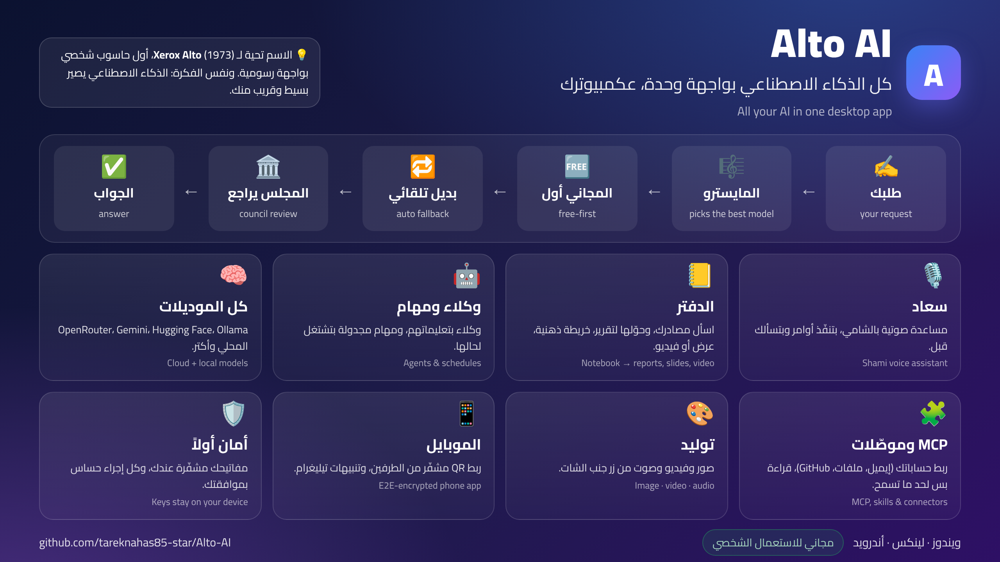

<h1 align="center">Alto AI</h1>

<p align="center">
  <b>Desktop AI agent for Windows and Linux</b><br>
  <b>وكيل ذكاء اصطناعي لسطح المكتب</b>
</p>

<div dir="rtl">

> **ليش اسمو Alto؟** سنة 1973، بمختبر **Xerox PARC** بمدينة بالو ألتو (ومنها إجا الاسم)، طلع جهاز اسمو **Xerox Alto**. كان أول حاسوب شخصي مبني كلو على واجهة رسومية: شاشة فيها نوافذ وأيقونات، وماوس، وشبكة بين الأجهزة. ما انباع للناس، بس فكرتو غيّرت كلشي: منو استوحت Apple الـLisa والـMac، وبعدين إجا Windows. يعني Alto هو اللي خلّى الكمبيوتر يصير لكل الناس، مو بس للمختصين.
>
> **وشو علاقتنا فيه؟** نفس الفكرة بس للذكاء الاصطناعي. اليوم في عشرات الموديلات والمفاتيح والمواقع، وكل وحدة إلها طريقتها. **Alto AI** بيجمعهن بواجهة وحدة بسيطة عكمبيوترك: بتكتب أو بتحكي طلبك، والبرنامج بيختار الموديل المناسب وبيبدأ بالمجاني. هدفنا متل هدف Alto الأصلي: تقنية قوية تصير سهلة وقريبة من أي حدا.

</div>

> **Why "Alto"?** In 1973, at **Xerox PARC** in Palo Alto (where the name comes from), Xerox built the **Alto**: the first personal computer designed around a graphical interface, with windows, icons, a mouse and networking. It was never sold to the public, yet it inspired the Apple Lisa and Macintosh, and later Windows. **Alto AI** follows the same idea for AI: many models, keys and services behind one simple desktop app that picks the right model for you and starts with the free ones.

<p align="center">
  
</p>

<p align="center">
  <a href="#english">English</a> &nbsp;·&nbsp; <a href="#arabic">بالعربي</a> &nbsp;·&nbsp; 📘 <a href="https://github.com/tareknahas85-star/Alto-AI/releases/latest/download/Alto-AI-Guide.html">Interactive guide · الدليل التفاعلي</a> &nbsp;·&nbsp; ▶️ <a href="https://www.youtube.com/@tanalabtech">YouTube</a>
</p>

<p align="center">
  <a href="https://youtu.be/1pAgZwKZ9tk"></a>
</p>

## Videos · الفيديوهات

| | |
|---|---|
| ▶️ **Full walkthrough · الشرح الكامل** (3 min · 3 دقايق) | [Watch · شوف](https://youtu.be/1pAgZwKZ9tk) |
| 📺 **Feature by feature · ميزة بميزة** (7 short episodes · 7 حلقات قصيرة) | [Playlist · القائمة](https://www.youtube.com/playlist?list=PLcNiveD7O_pU) |
| 🔔 **Channel · القناة** | [TaNa Lab on YouTube](https://www.youtube.com/@tanalabtech) |

## Download · التحميل

| | 📘 Guide · الدليل | Windows | Linux / Ubuntu | Android |
|---|---|---|---|---|
| **Latest · آخر نسخة** | [⬇️ Interactive guide · الدليل التفاعلي](https://github.com/tareknahas85-star/Alto-AI/releases/latest/download/Alto-AI-Guide.html) | [⬇️ Installer · المثبّت](https://github.com/tareknahas85-star/Alto-AI/releases/latest/download/Alto-AI-5.21.8-setup.exe) | [⬇️ .deb](https://github.com/tareknahas85-star/Alto-AI/releases/download/v5.21.8/Alto-AI-5.21.8-linux.deb) · [⬇️ AppImage](https://github.com/tareknahas85-star/Alto-AI/releases/download/v5.21.8/Alto-AI-5.21.8-linux.AppImage) | [⬇️ APK](https://github.com/tareknahas85-star/Alto-AI/releases/download/v5.21.5/Alto-AI-5.21.5-android.apk) |

📘 **Start here:** the interactive guide is one HTML file that works offline on any device. Download it and open it in any browser.
📘 **ابدأ من هون:** الدليل التفاعلي ملف واحد بيشتغل بلا نت على أي جهاز. نزّلو وافتحو بأي متصفح.

All files, release notes and `SHA256SUMS.txt` are on the [releases page](https://github.com/tareknahas85-star/Alto-AI/releases/latest).
كل الملفات وملاحظات الإصدار وملف `SHA256SUMS.txt` بـ[صفحة الإصدارات](https://github.com/tareknahas85-star/Alto-AI/releases/latest).

---

<a id="english"></a>

## English

A desktop AI agent for Windows and Linux. You type one request. A small "maestro"
model reads it, decides how hard it is, and picks the right model for the job,
cheapest first. If a model fails, the next one takes over on its own. The chat is
in Arabic first, right to left.

### Status

It works, but it is a personal project. Download the installer from the
[latest release](https://github.com/tareknahas85-star/Alto-AI/releases/latest),
or build it yourself. The Windows installer is not signed, so the first time
Windows SmartScreen shows a warning: press **More info**, then **Run anyway**.
Every release has a `SHA256SUMS.txt` file so you can check your download.

### What's new in 5.21.0

- **Android emulator inside the app.** The phone screen streams live into a side panel next to the chat, no separate window. Drag down from the top to open notifications, drag up from the bottom to open the app drawer, scroll with the mouse wheel, tap and long-press.
- **Smoother and faster.** The screen arrives as H.264 video and is decoded in the panel. The emulator runs on your GPU.
- **Ask the chat to use the phone.** Screenshot, read the screen, tap, type, press buttons, install an APK, open an app, build a Gradle project. Anything that changes something asks for your approval first.
- **Right-click copy and paste** in text fields.
- The mouse cursor over the emulator is a normal arrow.

Every change is in [CHANGELOG.md](CHANGELOG.md). Every release is on the [releases page](https://github.com/tareknahas85-star/Alto-AI/releases).

### What it does

- Sends every request to the best model: free first, then cheap, then expensive.
  Under each reply it shows the model, the speed, the tokens and the tools used
- Works with OpenRouter, Gemini, OpenAI, Anthropic, and your own
  OpenAI-compatible models. A local Ollama model can be the maestro
- Can use your Claude subscription instead of an API key (see below)
- Has tabs, projects, saved conversations, and a long-term memory it reads before
  every task
- Has a copy button and the date and time under every message, and the date of
  each conversation in the history
- Hands each request to a skill: Coding, Research, or File. A skill is a plain
  `SKILL.md` file you can edit or turn off
- Connects to your apps from one Connectors page, each with Connect, Test and
  Disconnect buttons: Google (Gmail, Drive, Calendar, Docs, Sheets), GitHub,
  Microsoft 365, Canva, Miro, Notion, Linear, Cloudflare, Dropbox, Box, Google
  Cloud, Terraform, Kubernetes, Browser Use, Deepgram, AssemblyAI docs, Desktop
  Commander, and Filesystem
- Keeps write access off for every service until you turn it on, and asks you
  before each risky action. Deleting is never allowed
- Has a council mode where a second model checks and fixes the first answer
- Has a spending guard with a "free models only" switch
- Skips a model that prints fake tool calls as text, and moves to the next one
- Has generate image / video / audio buttons next to the chat: each lists the models you can use with a daily limit, and the result lands in the chat. Your own custom models can be image, audio or video models too. The phone app has the same generation page
- Has a sign-in panel for the generation sites (Settings, Connectors) that shows the real sign-in state and lets you correct it by hand
- Runs in the system tray
- Has a **Notebook** page for sources, cited answers, reports, slides and video, a **Platforms** page that ranks the free models, and **Suaad**, a voice assistant (see What's new)

### How the maestro delegates

Every message goes through a small, fast maestro before any big model sees it.
The maestro does not answer you. It only decides how the request should be
handled:

```text
your message
   |
   v
 MAESTRO (local Ollama qwen3:1.7b -> OpenRouter free models -> keyword fallback)
   |  returns: complexity (simple/medium/complex), type (chat/code/research/file),
   |           which skill to use, and whether tools are needed
   +--> skill: Coding / Research / File (or any imported skill) --> its SKILL.md becomes the system prompt
   +--> tools: needed? --> builds a toolset from your enabled connectors (MCP) and project files
   +--> tier : simple = free then cheap | medium = free, cheap, expensive | complex = expensive first
   v
 chosen model answers (if it fails, the next model in the tier takes over)
```

**How a skill is picked.** A skill is a folder with a short `SKILL.md`, for
example "you are an expert programmer, explain step by step". The maestro picks
one of the three built-in skills (`delegate-coding`, `delegate-research`,
`delegate-file`) or one of your imported skills. For imported skills it only sees
the 8 names that fit the request best, so even a small local model can choose
well. The chosen `SKILL.md` becomes the system prompt, and your message is passed
as it is. A skill that is turned off is ignored.

**Why this helps**

- **Cheaper.** The cheap or local maestro does the thinking about the request.
  Expensive models are used only for complex work, and the "free models only"
  switch can block them.
- **Better answers.** The model gets instructions made for the job, and only the
  skill it needs is loaded, so the context stays small.
- **The right tools.** Connectors are attached only when the request needs them.
  Write tools stay hidden until you turn them on, and they still ask you first.
- **Easy to extend.** Add a skill by putting a `SKILL.md` in the skills folder, or
  from the Skills page. No code changes.
- **Hard to break.** If the local maestro is missing, the app uses OpenRouter,
  then a safe default. If a model fails, the next one answers.

### Council mode

Choose a council in the model menu under the chat box. The answer then goes
through one review round:

```text
1. draft    a model answers normally (tools, skills and memory work as usual)
2. critique a second model looks for real mistakes and missing parts, or says LGTM
3. revise   the first model fixes the valid points and gives the final answer
```

There are two ways to use it:

- **🏛️ Model council.** The app picks the writer and the critic, if possible from
  two different companies. It runs only for medium and complex requests that did
  not use tools.
- **🏛️ Council, I pick.** You choose the writer and the critic yourself, from any
  model in the menu. It runs for every request.

The draft shows first, and the final text replaces it when the review is done. If
the critic fails, you keep the draft. Expect about 2 to 3 times the usual time and
tokens. The chip under the answer shows who reviewed it and how many points were
fixed.

### Use your Claude subscription

If you have a Claude plan (Pro, Max, Team or Enterprise), you do not need an API
key. Install [Claude Code](https://docs.claude.com/en/docs/claude-code/overview)
and sign in to it once. The app then shows these models in the menu:

- Claude (your account's default model)
- Claude Sonnet
- Claude Opus
- Claude Haiku

The app runs the official `claude` command for each answer. It never reads or
saves your login. The answers use your plan's limits, not API credit. With these
models the answer arrives in one piece, and connector tools are off. You can also
pick them as the writer or the critic in a council.

### What you need

- Windows 10 or 11, or Ubuntu / Debian (64-bit)
- An API key from at least one provider (an OpenRouter key with free models is
  enough to start), or a Claude plan with Claude Code signed in
- Optional: [Ollama](https://ollama.com) for a local maestro, and Node.js 20 or
  newer if you build it yourself

On Linux, computer control (it uses PowerShell) works on Windows only for now.
Everything else works. The `.deb` is the best choice on Ubuntu. The AppImage runs
with `--no-sandbox` on Ubuntu 24.04.

### Getting started, step by step

The app ships with **no keys, no accounts and no personal settings**. Everyone who
downloads it adds their own. Nothing below needs a developer.

1. **Install.** Download the installer from the
   [latest release](https://github.com/tareknahas85-star/Alto-AI/releases/latest)
   and run it. Windows SmartScreen may warn you (the installer is not signed):
   press **More info**, then **Run anyway**.
2. **Add at least one model.** Open **الموديلات (Models)** in the side bar, pick a
   provider on the left (OpenRouter is the easiest, it has free models), paste your
   API key and press **تحقق (Verify)**. The test tells you if the key works. If it
   says the request is blocked by region (403), that is your country or IP, not
   your key: use a VPN or use OpenRouter.
3. **Or use your Claude plan.** Install Claude Code, sign in once, and the Claude
   models appear in the menu (see "Use your Claude subscription").
4. **Optional: a local maestro.** Install [Ollama](https://ollama.com) and pull
   `qwen3:1.7b`. Without it, the app uses OpenRouter free models.
5. **Chat.** Go to **المحادثات (Chats)**, type a request, and pick **Auto**, a
   model, or a council from the menu under the box. Attach files with **+**, drag
   and drop, or paste.
6. **Connect your apps (optional).** **الإعدادات ← الموصلات (Settings ← Connectors)**
   and **الإضافات (Plugins)**. Write access is off for every service until you turn
   it on, and risky actions always ask you first.
7. **Alerts and backup (optional).** **الإعدادات ← عام (Settings ← General)** has
   Telegram alerts and an encrypted settings export/import (`.trlx`, protected by a
   password you choose).
8. **Phone app (optional).** See the next section.

Your keys and settings stay on your own computer, in the app's data folder.

### Phone app (Android)

A small Android app that lets you use your computer's Alto AI from your phone:
chat, choose the model or mode, approve risky commands, watch long tasks, and send
files, photos and voice notes to the app. **Everything runs on your computer. The
phone is only a screen.**

**Set it up (about 3 minutes)**

1. Install the desktop app and make sure it works (steps above).
2. Download **`Alto-AI-5.21.5-android.apk`** from the
   [latest release](https://github.com/tareknahas85-star/Alto-AI/releases/latest)
   on your phone and install it (Android asks you to allow installing from this
   source once). It is a debug-signed build, not from the Play Store.
3. On the computer: **Settings ← General ← Phone app**. Turn on **Enable phone
   link**. When Windows Firewall asks, allow **Private networks**.
4. Press **ربط جهاز جديد (Pair a new device)**. A QR code appears.
5. Open the app on the phone. It asks for the camera and scans the QR. A 6-digit
   code shows on both screens. If they are the same, confirm on the computer.
6. Done. Now you can chat from the phone.

**Using it away from home (optional)**

By default the phone reaches your computer over the same Wi-Fi. To use it from
anywhere you need a small relay. It is blind: it only passes encrypted messages and
cannot read them. The free Cloudflare plan is enough:

```bash
cd relay/worker
npx wrangler login      # use YOUR Cloudflare account
npx wrangler deploy     # prints https://trl-relay.<your-name>.workers.dev
```

Then put `wss://trl-relay.<your-name>.workers.dev` in **Settings ← General ← Phone
app ← relay address**, save, and pair the phone again with a new QR (the address is
stored on the phone at pairing time). See [`relay/README.md`](relay/README.md).

**Security**

- Pairing uses a one-time QR that expires after 2 minutes, plus a 6-digit match
  code you confirm on the computer.
- Messages are end to end encrypted (X25519 + XChaCha20-Poly1305, new keys for
  every connection). The relay and the network see only encrypted bytes.
- Command approvals from the phone are signed by the phone and tied to the exact
  command, so they cannot be replayed.
- Confidential projects are never available from the phone. Dangerous commands
  (delete, format) can be approved from the phone only if you turn that on.
- You can remove any paired phone with one click in the same settings page.

**Good to know:** the computer must be on, with the app running. The app is Android
only. Messages you send from the phone run as their own sessions and do not appear
in the desktop chat window yet.

### How to build it

```bash
npm install
npm run dev          # run in development
npm run build:win    # build the Windows installer into release/
npm run build:linux  # build the AppImage and .deb on Ubuntu / Debian
```

### Your data

Everything stays on your computer. Your API keys and connector settings are saved
in the app's data folder. Nothing is sent anywhere except to the providers and
apps you choose.

### Built with

Electron, React, TypeScript, electron-vite, Tailwind CSS, electron-store, the
Vercel AI SDK, the Model Context Protocol (MCP), and electron-builder for the Windows and Linux
installers.

---

### License

Alto AI is free for personal, educational, research and non-profit use.
It is **source-available, not open source**. You may not use it commercially,
modify it, or republish it anywhere except this repository. Want to use it in
a business? Write to tareknahas@live.com. Full terms are in [LICENSE](LICENSE),
and the licenses of the libraries it uses are in
[THIRD_PARTY_NOTICES.txt](THIRD_PARTY_NOTICES.txt).

### Contributors

- Tarek Nahas - design and idea, author and maintainer
- AI - implementation

---

<a id="arabic"></a>

## بالعربي

<div dir="rtl">

**Alto AI** برنامج ذكاء اصطناعي بيشتغل عكمبيوترك (ويندوز أو لينكس). إنت بتكتب طلب واحد، وفي "مايسترو" صغير بيقرا الطلب وبيقدّر قديش هو صعب، وبيختار أنسب موديل للشغلة وبيبدأ بالأرخص (وغالباً المجاني). وإذا موديل فشل، التاني بياخد مكانو لحالو. المحادثة بالعربي أولاً ومن اليمين لليسار.

> هاد مشروع شخصي بس شغّال. كل شي بيضل عجهازك، ومفاتيحك وبياناتك ما بتنبعت لأي جهة غير المزوّدين اللي إنت بتختارهم.

### المحتويات

1. [شو الجديد بآخر نسخة](#whatsnew-ar)
2. [شو بتحتاج](#needs-ar)
3. [التثبيت خطوة خطوة](#install-ar)
4. [أول مرة بتفتح البرنامج](#first-ar)
5. [جولة بالبرنامج: كل صفحة وكل زر](#tour-ar)
6. [كيف تضيف موديلات](#models-ar)
7. [كيف تضيف سكيلز](#skills-ar)
8. [الأدوات وسيرفرات MCP](#tools-ar)
9. [ربط حساباتك (الموصّلات)](#accounts-ar)
10. [الدفتر وملفات Drive](#notebook-ar)
11. [سعاد (المساعدة الصوتية)](#suaad-ar)
12. [التحكم بالجهاز والأمان](#security-ar)
13. [تطبيق الموبايل وتنبيهات تيليغرام](#phone-ar)
14. [حل المشاكل الشائعة](#trouble-ar)
15. [كيف يشتغل المايسترو والمجلس](#how-ar)
16. [للمطوّرين: بناء البرنامج، بياناتك، الترخيص](#dev-ar)

<a id="whatsnew-ar"></a>

### شو الجديد بآخر نسخة (5.21.0)

- **المحاكي جوّا البرنامج.** شاشة الأندرويد بتنبث مباشرة بلوحة جنب الشات، بدون نافذة منفصلة. اسحب من فوق لتحت لتفتح الإشعارات، ومن تحت لفوق لتفتح درج التطبيقات، وسكرول بعجلة الماوس، وضغط وضغط مطوّل.
- **أنعم وأسرع.** الشاشة بتوصل فيديو H.264 بيتفك جوّا اللوحة، والمحاكي بيشتغل على كرت الشاشة.
- **اطلب من الشات يستعمل التلفون.** لقطة شاشة، قراءة عناصر الشاشة، ضغط، كتابة، أزرار، تثبيت APK، فتح تطبيق، وبناء مشروع Gradle. أي شي بيغيّر شي بيطلب موافقتك أول.
- **نسخ ولصق بالماوس اليمين** بخانات الكتابة.
- مؤشر الماوس فوق شاشة المحاكي صار سهم عادي.

كل التفاصيل بملف [CHANGELOG.md](CHANGELOG.md)، وكل نسخة بـ[صفحة الإصدارات](https://github.com/tareknahas85-star/Alto-AI/releases).

<a id="needs-ar"></a>

### شو بتحتاج

| الشي | ليش |
|---|---|
| ويندوز 10 أو 11، أو أوبونتو / ديبيان (64 بت) | لتشغيل البرنامج |
| مفتاح API من مزوّد واحد على الأقل | هاد "المفتاح" اللي بيخلي الموديل يجاوب. أسهل واحد: **OpenRouter** (فيه موديلات مجانية) |
| إنترنت | الموديلات السحابية بتحتاج إنترنت (Ollama المحلي ما بيحتاج) |
| اختياري: [Ollama](https://ollama.com) | لتشغيل موديل صغير عجهازك بدون إنترنت، وليكون هو المايسترو |
| اختياري: اشتراك Claude + Claude Code | لاستعمال اشتراكك بدل مفتاح API |

على لينكس، التحكم بالجهاز (بيعتمد على PowerShell) بيشتغل عويندوز بس حالياً، وباقي الميزات شغّالة. ملف `.deb` هو الأفضل على أوبونتو، والـ AppImage بيشتغل مع `--no-sandbox` على أوبونتو 24.04.

<a id="install-ar"></a>

### التثبيت خطوة خطوة

<details open>
<summary><b>ويندوز</b></summary>

1. افتح [صفحة الإصدارات](https://github.com/tareknahas85-star/Alto-AI/releases/latest) ونزّل الملف اللي آخرو `windows-setup.exe`.
2. دوس عليه دبل كليك لتشغّلو.
3. ممكن يطلعلك شاشة زرقاء من ويندوز اسمها **SmartScreen** وبتقول "Windows protected your PC". هاد عادي لأنو المثبّت مو موقّع (التوقيع بيكلّف مصاري). دوس **More info** وبعدين **Run anyway**.
4. كمّل التثبيت وافتح البرنامج. بيطلعلك أيقونة بشريط النظام (جنب الساعة).
5. اختياري للتأكد إنو الملف سليم: نزّل `SHA256SUMS.txt` من نفس الصفحة، وشغّل `Get-FileHash` على ملفك بـPowerShell وقارن الرقم.

</details>

<details>
<summary><b>لينكس (أوبونتو / ديبيان)</b></summary>

1. نزّل ملف `.deb` من صفحة الإصدارات.
2. ثبّتو: دبل كليك عليه، أو من التيرمينال اكتب: `sudo apt install ./Alto-AI-5.21.8-linux.deb`
3. بديل: ملف `AppImage`. اعطيه صلاحية التشغيل بـ `chmod +x Alto-AI-5.21.8-linux.AppImage` وبعدين شغّلو. على أوبونتو 24.04 أضف `--no-sandbox` بآخر الأمر.

</details>
<details>
<summary><b>أندرويد (تطبيق الموبايل)</b></summary>

التطبيق بيتصل ببرنامج الكمبيوتر، فلازم تثبّت برنامج الكمبيوتر أول وتتأكد إنو شغّال. بعدها شوف قسم [تطبيق الموبايل](#phone-ar).

</details>

<a id="first-ar"></a>

### أول مرة بتفتح البرنامج

أول مرة بتطلعلك شاشة ترحيب فيها 3 خطوات بسيطة:

1. **اسمك** (اختياري): بيناديك فيه البرنامج.
2. **مفتاح OpenRouter** (اختياري للبداية بس منصحك فيه): هاد المفتاح بيفتحلك موديلات كتيرة، وفيها مجانية.
   - افتح [openrouter.ai](https://openrouter.ai) وسجّل دخول.
   - دوس **Keys** ← **Create Key**.
   - انسخ المفتاح (بيبدأ بـ `sk-or-`) والصقو بالشاشة. البرنامج بيجيب الموديلات وبيفعّل الافتراضية لحالو.
3. **يلا نبدأ.** ممكن تدوس **تخطي** وتضيف المفتاح بعدين من صفحة الموديلات.

> ملاحظة مهمة: البرنامج **ما بيستعمل حسابات الاشتراك الشخصية** (متل ChatGPT Plus أو Gemini Advanced) لتسجيل الدخول، لأنو شروط هالخدمات بتمنع هيك. كل واحد بيحط مفاتيح API من حسابو، وهو مسؤول عن شروط كل مزوّد.

</div>

<div dir="rtl">

<a id="tour-ar"></a>

### جولة بالبرنامج: كل صفحة وكل زر

الشريط الجانبي (عاليمين) فيه 10 صفحات. هاد شو بتعمل كل وحدة:

| الصفحة | شو بتعمل ولمين بتنفع |
|---|---|
| **المحادثات** | الصفحة الأساسية. بتكتب طلبك والبرنامج بيجاوب. بتقدر تفتح كم تبويب بنفس الوقت. |
| **المشاريع** | بتضيف مجلدات مشاريعك. الموديل بيشوف ملفاتها وبيقراها. كل مشروع إله تبويب خاص. |
| **المهام** | مهام مجدولة: بتعطيه أمر مرة وحدة وهو بينفذو بالوقت اللي بتحدده (مثلاً كل يوم الساعة 12). |
| **وكلاء** | بتعمل "وكيل" إله اسم وتعليمات (مثلاً: باحث)، وبتختار وين بيشتغل (عالكمبيوتر أو سحابي). |
| **ملاحظات** | قائمة مهامك الشخصية. كل سطر بتلصقو بيصير مهمة، ومتزامنة مع تطبيق الموبايل. |
| **دفتر** | مصادرك (ملفات، روابط، نصوص، Drive) مع أسئلة وأجوبة بالاقتباس وتقارير وفيديو. |
| **الموديلات** | هون بتحط مفاتيحك وبتضيف موديلات وبتفحصها. |
| **المنصات** | ترتيب كل الموديلات المجانية من كل المزوّدين حسب القوة، وزر "اختبر المفتاح واسحب المجاني". |
| **الإضافات** | 3 تبويبات: **MCP Servers** و**السكيلز** و**الأدوات**. هون بتوسّع قدرات البرنامج. |
| **الإعدادات** | 3 تبويبات: **عام** (التحكم بالجهاز، تيليغرام، تطبيق الموبايل، نقل الإعدادات)، **الموصّلات** (ربط حساباتك)، **الذاكرة**. |

بالأسفل بالشريط الجانبي: زر **محادثة جديدة**، وخانة **بحث بالمحادثات**، وأزرار الجرس والمظهر (فاتح/غامق) واللغة.

#### أزرار صفحة المحادثات

<details>
<summary><b>الشريط اللي فوق: شو هالمربعات الصغيرة؟</b></summary>

- **اليوم 0/50**: كم طلب مجاني استعملت اليوم.
- **MCP 27/29**: كم سيرفر MCP شغّال من المضافين.
- **ماستر محلي / Ollama / OpenRouter**: نقطة خضرا يعني شغّال، حمرا يعني مو متصل. الماستر المحلي بدو Ollama.
- **وفّرت N طلبات مجانية، N رخيصة، N ردود**: عدّاد بيبيّن قديش اشتغل عالمجاني.

</details>

<details>
<summary><b>تحت مربع الكتابة: الأوضاع والموديل</b></summary>

- **محادثة عادية / بناء مشروع / المجلس**: وضع الشغل. "بناء مشروع" بيخلي البرنامج ينفّذ شغل أطول على ملفات مشروعك. "المجلس" بيخلي موديل تاني يراجع الجواب (شوف [المجلس](#how-ar)).
- **قائمة الموديل** (مثلاً "تلقائي — مجاني أولاً"): اختار **تلقائي** وخلّي البرنامج يقرر، أو اختار موديل محدد. "تلقائي — الأقوى أولاً" بيجرّب أقوى موديل أول.
- **التفكير** (Low / Medium / High): كم يفكّر الموديل قبل ما يجاوب. الأعلى أدق وأبطأ.
- **شغّل المايسترو**: مربع اختياري. إذا مشغّل، المايسترو بيقرا طلبك أول وبيختار المهارة والأدوات.
- **اقتراحات سريعة** فوق مربع الكتابة: لخّص ملف، عرض PowerPoint، مستند Word، تقرير Excel، راجع إيميل، سكربت PowerShell. دوس عليها وبتبدأ.

</details>

<details>
<summary><b>الأزرار جنب مربع الكتابة</b></summary>

- **سهم الإرسال**: بيبعت الرسالة. (Enter للإرسال، Shift+Enter لسطر جديد.)
- **مشبك الورق**: إرفاق ملفات (صوت، Office، صور، PDF، نصوص). كمان بتقدر تسحب وتفلت أو تلصق.
- **أزرار التوليد** (صورة، فيديو، صوت): كل زر بيعرض الموديلات المتاحة مع الحد اليومي، والنتيجة بتطلع بالشات.
- **المايك**: تحكي والبرنامج بيكتب كلامك.
- **السماعات**: محادثة صوتية مباشرة (شوف [سعاد](#suaad-ar)).
- **الأذن**: كلمة التنبيه. مطفية افتراضياً. لما تشغّلها بتقول «سعاد» وبتفتح المحادثة الصوتية.
- **تحت كل رد**: اسم الموديل اللي جاوب فعلاً، السرعة، التوكنات، الأدوات المستعملة، وزر **نسخ** وزر **اقرأ بصوت**، وتاريخ ووقت الرسالة.
- **زر الإيقاف** بيوقّف الطلب الشغّال.

</details>

<a id="models-ar"></a>

### كيف تضيف موديلات

الموديل هو "العقل" اللي بيجاوب. كل موديل بيجي من **مزوّد**، والمزوّد بيعطيك **مفتاح API** (كلمة سر طويلة). فالخطوات دايماً: **جيب مفتاح ← الصقو ← اختبرو**.

#### الطريقة 1: المزوّدين الجاهزين

1. افتح **الموديلات** من الشريط الجانبي.
2. من القائمة اللي عاليمين اختار المزوّد (OpenRouter، APInex، Hugging Face، Gemini، OpenAI، Anthropic).
3. الصق المفتاح بخانة **مفتاح API** (بينحفظ مشفّر عجهازك بس).
4. دوس **اختبار وكشف الموديلات**. بيطلعلك إذا المفتاح شغّال وكم موديل متاح.

| المزوّد | من وين بتجيب المفتاح | مجاني؟ |
|---|---|---|
| **OpenRouter** | [openrouter.ai](https://openrouter.ai) ← Keys ← Create Key | فيه موديلات مجانية (`:free`) |
| **Google Gemini** | [aistudio.google.com](https://aistudio.google.com) ← Get API key | فيه طبقة مجانية بحدود، شوف شروطها |
| **Anthropic (Claude)** | [console.anthropic.com](https://console.anthropic.com) ← API Keys | مدفوع حسب الاستعمال |
| **OpenAI** | [platform.openai.com](https://platform.openai.com) ← API keys | مدفوع حسب الاستعمال |
| **Hugging Face** | [huggingface.co](https://huggingface.co) ← Settings ← Access Tokens | فيه موديلات رؤية مجانية |
| **APInex** | بوابة فيها موديلات مجانية بدون اشتراك | مجاني |

> إذا ما عندك مصاري تدفع، ابدأ بـ **OpenRouter** أو **Gemini**، وخلّي الوضع **تلقائي — مجاني أولاً**.

#### الطريقة 2: موديل مخصص (أي مزوّد متوافق مع OpenAI)

1. بصفحة **الموديلات** دوس **+ جديد** جنب قسم **موديلات مخصصة**.
2. اكتب اسم الموديل، والـ **API host** (عنوان المزوّد، مثلاً `https://api.example.com/v1`)، والمفتاح.
3. اختار النوع: **محادثة** أو **توليد صور** أو **توليد صوت** أو **توليد فيديو**.
4. دوس **اختبار** جنب الموديل. وإذا بدك تجيب كل موديلاته المجانية بضغطة دوس **جلب المجانية**.
5. زر **بينجرّب: أول / بعد** بيحدد إذا هالموديل بيتجرّب قبل موديلات OpenRouter أو بعدها.
6. زر **المفتاح** لتغيير مفتاحو، وزر الحذف لإزالتو.

#### الطريقة 3: موديل محلي بدون إنترنت (Ollama أو LM Studio)

1. ثبّت [Ollama](https://ollama.com) وشغّلو.
2. نزّل موديل صغير (المنصوح للمايسترو: `qwen3:1.7b`) بأمر `ollama pull qwen3:1.7b`.
3. البرنامج بيلقاه لحالو وبيعرضو بقسم **محلي (Ollama / LM Studio)**.

#### الطريقة 4: اشتراك Claude بدل مفتاح

إذا عندك اشتراك Claude (Pro أو Max أو Team أو Enterprise) ثبّت [Claude Code](https://docs.claude.com/en/docs/claude-code/overview) وسجّل دخول فيه مرة وحدة. بتطلع بالقائمة موديلات Claude (الافتراضي، Sonnet، Opus، Haiku). البرنامج بيشغّل أمر `claude` الرسمي وما بيقرا ولا بيحفظ بيانات دخولك. الأجوبة بتنحسب من حدود اشتراكك مو من رصيد API، وبتوصل دفعة وحدة وأدوات الموصّلات بتكون مطفية.

#### شو معنى ألوان الفحص؟

لما تدوس **فحص المفاتيح والموديلات** (أو **فحص كامل** بالتبويبات التانية) بيجرّب كل شي وبيعرض النتيجة:

| اللون | المعنى | شو تعمل |
|---|---|---|
| **أخضر ✓** | شغّال | ولا شي |
| **رمادي ➖** | "مو مجاني أو خلصت حصتو (429)". المفتاح سليم، الموديل بس مو بالطبقة المجانية | استعمل موديل تاني مجاني، أو استنى لبكرا |
| **أحمر ✗** مع "أعد المحاولة" | بطيء أو مزحوم هلأ | جرّب بعد شوي |
| **أحمر ✗** برسالة تانية | مشكلة حقيقية، غالباً مفتاح غلط أو منتهي | تأكد من المفتاح، وإذا قال **403** فهاد حجب حسب بلدك، استعمل VPN أو OpenRouter |

#### صفحة المنصات

بتعرض ترتيب عام لكل الموديلات المجانية من كل المزوّدين حسب القوة (الدرجة تقدير من الاسم والحجم مو قياس فعلي). بتقدر تفعّل **المجاني فقط**، وكل مزوّد عندو زر **اختبر المفتاح واسحب المجاني**، وبتقدر تضيف منصة جديدة بالاسم والعنوان والمفتاح.

<a id="skills-ar"></a>

### كيف تضيف سكيلز

**السكيل** هو "وصفة جاهزة" للموديل: ملف نصي قصير فيه تعليمات متل "إنت مبرمج خبير، اشرح خطوة بخطوة". المايسترو بيختار السكيل المناسب لحاله حسب طلبك. في 3 سكيلز مدمجة: **coding** (برمجة) و**research** (بحث) و**file** (ملفات).

1. افتح **الإضافات** ثم تبويب **السكيلز**.
2. دوس **ضيف سكيل**.
3. اكتب **اسم السكيل** وبعدين التعليمات بالخانة الكبيرة (System Prompt).
4. دوس **حفظ**. إذا لقى فحص الأمان ملاحظة بيطلعلك تحذير: اقرا النص مرة تانية قبل ما تحفظ.
5. بالقائمة بتقدر **تفعّل** أو **تعطّل** أي سكيل، **تدوّر** باسمو، أو تفعّل/تعطّل كل يلي ظاهر، أو **تحذف**.

> بتقدر كمان تستورد سكيلز جاهزة من Claude أو ChatGPT: شوف **الإضافات ← MCP Servers ← استيراد من Claude / ChatGPT / Google**.

</div>

<div dir="rtl">

<a id="tools-ar"></a>

### الأدوات وسيرفرات MCP

بصفحة **الإضافات**:

- **الأدوات**: هي قدرات جاهزة للبرنامج (قراءة وكتابة ملفات، git، بحث بالنت، zip، وغيرها). لكل أداة زر **تفعيل / تعطيل**. عطّل اللي ما بدك ياه، وفعلاً بيتمنع. وبتقدر **تضيف أداتك** (أمر بتنفذو على جهازك، وبيطلب موافقتك كل مرة).
- **MCP Servers**: سيرفرات جاهزة بتعطي البرنامج قدرات جديدة (متل ما بتعمل بـ Claude Desktop). دوس **ضيف سيرفر**، واكتب **الأمر + الوسائط + متغيرات البيئة**. أو دوس **استيراد من Claude / ChatGPT / Google** وهو بيفحص ملفات الإعدادات عندك وبيجيب السيرفرات والسكيلز اللي لقاها، وبتقدر كمان تلصق JSON. السيرفرات المستوردة بتنضاف **مطفية**، جرّب **اختبار** وبعدين فعّلها.

<a id="accounts-ar"></a>

### ربط حساباتك (الموصّلات)

الموصّل بيخلي البرنامج يقرا (وإذا سمحت يكتب) بحساب من حساباتك: إيميل، ملفات، تقويم، مشاريع... افتح **الإعدادات ← الموصّلات**. الموصّلات مقسّمة: **شغل ومكتب**، **تطوير**، **سحابة وبنية تحتية**، **تصميم ووسائط**، **بحث ومعلومات**، **أدوات الجهاز**.

لكل موصّل حالة: **متصل ✓** أو **مش متصل** أو **بدو إعداد (مرة وحدة)**. وفيه أزرار **اتصل** و**اختبار** و**فصل**.

<details>
<summary><b>ربط حساب Google (Gmail, Drive, Calendar, Docs, Sheets)</b></summary>

بدو إعداد مرة وحدة لأنو Google بدها منك "تطبيق" إنت بتعملو:

1. افتح [Google Cloud Console](https://console.cloud.google.com) وسجّل بحسابك، واعمل **مشروع** جديد.
2. فعّل الـ APIs اللي بدك ياها (Gmail API، Drive API، Calendar API...) من **APIs & Services ← Library**.
3. جهّز شاشة الموافقة: **Google Auth Platform** (أو OAuth consent screen). اختار **External** وضيف إيميلك كـ **Test user**.
4. من **Clients** اعمل **OAuth client** من نوع **Desktop app**، ونزّل ملف الـ JSON.
5. بالبرنامج: **الإعدادات ← الموصّلات ← Google** ← **إعداد لمرة وحدة**، والصق محتوى ملف الـ JSON كامل بالخانة الأولى (أو الـ Client ID والـ Client secret)، ودوس **حفظ الإعداد**.
6. اكتب إيميلك ودوس **اتصل**، وبيفتح المتصفح، وافق عالصلاحيات. بتلاقي الحالة **متصل ✓**، ودوس **اختبار** للتأكد.

ملاحظة: إذا مشروعك بوضع **Testing** فالربط بينتهي كل 7 أيام، وبتدوس **اتصل** من جديد.

</details>

<details>
<summary><b>ربط باقي الحسابات (GitHub, Microsoft 365, Notion, Linear...)</b></summary>

1. دوس **اتصل** عالموصّل.
2. بيطلعلك **كود**، والبرنامج بيفتح صفحة تسجيل دخول. **الصق الكود** بهاي الصفحة ووافق.
3. بعض الموصّلات بتطلب **Token** (مفتاح) بتلصقو بدل الكود. دوس **اختبار** للتأكد. بعض الموصّلات (متل Cloudflare أو Kubernetes أو Terraform) بتحتاج أدوات أو مفاتيح عجهازك، وبيكتبلك "بيحتاج: ..." إذا ناقص شي.
4. **إضافة موصّل**: بتضيف موصّل خاص فيك. بيظهر بعدها بـ **الإضافات ← MCP Servers** وبتفعّلو وبتختبرو من هناك.

</details>

<details>
<summary><b>السماح بالكتابة، وشو ممنوع دايماً</b></summary>

- افتراضياً كل موصّل **قراءة فقط**. إذا بدك الموديل يرسل إيميل أو ينشئ مواعيد أو يعدّل ملفات، فعّل خيار **السماح بالكتابة**، وهاد دايماً **بيطلب موافقتك قبل كل إجراء**.
- **الحذف النهائي ممنوع دايماً**، حتى لو فعّلت الكتابة.
- Google Keep ما إلو واجهة رسمية، فالملاحظات بتنعمل عبر Docs أو Drive.

</details>

<details>
<summary><b>حسابات مواقع التوليد (صورة / فيديو / صوت)</b></summary>

بنفس الصفحة (**الموصّلات**) في لوحة **حسابات مواقع التوليد**. بتسجّل دخول مرة وحدة جوا البرنامج وبيضل محفوظ. البرنامج ما بينسخ شي من كروم أو إيدج، فحساباتك هونيك ما بتتأثر. بتعرض الحالة (مسجّل دخول ✓ / غالباً مسجّل / مو مسجّل) وبتقدر تصحّحها بإيدك أو تسجّل خروج.

</details>

<a id="notebook-ar"></a>

### الدفتر وملفات Drive

**الدفتر** هو مكان بتحط فيه مصادرك وبتسألها. الأجوبة **مبنية على مصادرك بس** ومعها أرقام المصادر، فما في تأليف من برا.

1. افتح **دفتر** ودوس **دفتر جديد** وسمّيه.
2. ضيف مصادر: **ملفات** (PDF، Word، نصوص...)، **روابط**، أو **نصوص** بتلصقها، أو **ملفات من Google Drive** (تحت).
3. اكتب سؤالك بخانة الأسئلة، وبتجيك الإجابة مع الاقتباس.
4. حوّل مصادرك لمخرج جاهز: **تقرير**، **جدول بيانات**، **خريطة ذهنية**، **بطاقات مراجعة** (دوس البطاقة لتقلبها)، **اختبار**، **عرض تقديمي** (pptx)، **إنفوغرافيك** (صفحة HTML)، **ملخّص صوتي** (حوار شامي بين مذيعين اسمهم أمل وليث، بتسمعو أو بتصدّرو mp3). كل مخرج عندو زر **تصدير**.

**فيديو من العرض التقديمي:** دوس **حوّلو لفيديو (مجاني، محلي)**. البرنامج بيعمل تعليق صوتي لكل شريحة بصوت **سعاد** (من Gemini، لازم مفتاح Gemini)، وإذا Gemini مو متاح بيرجع لصوت احتياطي وبيعلمك. بيرسم الشرايح وبيسجّلها بالوقت الحقيقي (مدة الفيديو = مدة الكلام)، وبعدين دوس **احفظ الفيديو (webm)**. بدون ffmpeg وبدون أي خدمة مدفوعة.

<details>
<summary><b>ربط Google Drive بالدفتر (قراءة فقط)</b></summary>

بنفس فكرة ربط Google فوق (إعداد مرة وحدة):

1. من Google Cloud Console فعّل **Google Drive API**.
2. جهّز شاشة الموافقة، وضيف إيميلك كـ **Test user**.
3. اعمل **OAuth client** من نوع **Desktop app** ونزّل ملف `client_secret_….json`.
4. بالدفتر، قسم المصادر، دوس **ملفات من Google Drive** ثم **استورد ملف الاعتماد** واختار الملف (بينحفظ مشفّر عندك).
5. دوس **اربط Drive**. بيفتح المتصفح، ووافق على **قراءة ملفاتك بس**.
6. اكتب بخانة **دوّر** (بالمحتوى أو الاسم، وفاضي = الأحدث) ودوس **دوّر**، وبعدين **ضيف** عالملف اللي بدك ياه.
7. لإلغاء الربط دوس **افصل Drive**.

المستندات والعروض بتنقرا كنص، والجداول كـ CSV، والـ PDF وWord مثل أي ملف مرفوع. ما في صلاحية تعديل أو حذف أبداً. وإذا مشروعك بوضع **Testing** فالربط بينتهي كل 7 أيام.

</details>

</div>

<div dir="rtl">

<a id="suaad-ar"></a>

### سعاد (المساعدة الصوتية)

سعاد بتخليك تحكي مع البرنامج بصوتك، وبتجاوبك بصوت.

- **زر السماعات** (جنب مربع الكتابة) بيفتح محادثة صوتية. إذا عندك **مفتاح Gemini** بتشتغل مباشرة (Gemini Live): بتقاطعها وبتسكت لحالها، والكلام بينكتب بالشات. وإذا ما في مفتاح أو فشل الاتصال بترجع للوضع المحلي (Whisper للتفريغ). فيك تتخطّى القراءة أو توقّف المحادثة من الشريط العايم.
- **زر الأذن** (كلمة التنبيه): **مطفي افتراضياً**. لما تشغّلو بيسمع المايك محلياً (ما بيطلع صوت من جهازك) ولما تقول **«سعاد»** بيفتح المحادثة الصوتية.
- **تنفيذ الأوامر بالصوت:** سعاد بتستعمل أدوات الجهاز مباشرة (شو فاتح، شو عالشاشة، فتح تطبيق، كتابة، ضغط، قراءة ملفات، إغلاق تطبيق)، وبتسألك قبل ما تنفّذ: قول **«أوكي»** إذا موافق. الأوامر الخطيرة (حذف، فرمتة، أدمن) بتضل بتحتاج تأكيد من الشاشة.
- **الصلاحية الكاملة:** قول **«انتِ المسؤولة هلأ»** وبتنفّذ الأوامر العادية بدون ما تسألك. و**«رجّعيلي الصلاحية»** بترجّع الأسئلة. بتنتهي لحالها بعد 30 دقيقة أو لما تسكّر المحادثة الصوتية، والإجراءات الحسّاسة لسا بتحتاج تأكيد.
- **الأورب:** دايرة شفافة صغيرة بزاوية الشاشة بتبيّن شو عم تعمل سعاد: نقطة خفيفة = عم تسمع الكلمة، أخضر = عم تسمعك، برتقالي = عم تفكر، أزرق نابض = عم تحكي. بتختفي لما يكون البرنامج قدامك.
- **التحكم بالجهاز لازم يكون مفعّل** عشان سعاد تقدر تفتح وتضغط وتكتب (شوف القسم اللي بعدو). وهو لويندوز بس حالياً.

<a id="security-ar"></a>

### التحكم بالجهاز والأمان

- **التحكم بالجهاز** (**الإعدادات ← عام**): بيخلي الموديلات تشغّل أوامر PowerShell، تقرا الملفات، تفتح البرامج، وتضغط وتكتب عالشاشة. **مطفي افتراضياً**، وكل إجراء بيطلب موافقتك. خياراتو: **فعّل الموافقة التلقائية** (ينفّذ بدون ما يسألك، والمحجوب يبقى محجوب)، و**فعّل الصلاحية الكاملة**. الأوامر المدمّرة (حذف، فرمتة، حذف ريجستري) **بتطلب تأكيدك كل مرة** مهما كان الخيار. ولينكس: غير متاح بهالنسخة.
- **مشروع سري:** بتشيل أو بتحط علامة 🔒 على المشروع. المشروع السري بيستعمل **بس موديلات مدفوعة قوية**، والتحليل محلي، وما بيظهر عتطبيق الموبايل ولا بتنبيهات تيليغرام بالتفاصيل.
- **مفاتيحك:** بتنحفظ مشفّرة عجهازك بس.
- **الموصّلات:** قراءة فقط لحد ما تفتح الكتابة، والحذف النهائي ممنوع.
- **حارس الإنفاق:** تبويبات المحادثة الجديدة بتبدأ على **المجاني فقط** إلا إذا طفّيت الحارس العام.

<a id="phone-ar"></a>

### تطبيق الموبايل وتنبيهات تيليغرام

#### تطبيق الأندرويد

تطبيق صغير بيخليك تستعمل البرنامج اللي عالكمبيوتر من تلفونك: شات، اختيار الموديل أو الوضع، موافقة عالأوامر الحساسة، متابعة المهام الطويلة، وإرسال ملفات وصور ورسائل صوتية. **كل الشغل بيصير عالكمبيوتر، والتلفون بس شاشة.** وفيه كمان صفحة التوليد وتبويب الملاحظات.

**كيف تجهّزو (حوالي 3 دقايق):**

1. ثبّت برنامج الكمبيوتر وتأكد إنو شغّال.
2. نزّل ملف `Alto-AI-5.21.5-android.apk` من [صفحة الإصدارات](https://github.com/tareknahas85-star/Alto-AI/releases/tag/v5.21.5) عالتلفون وثبّتو. أندرويد بيطلب منك تسمح بالتثبيت من هالمصدر مرة وحدة. هاد ملف تجريبي موقّع debug، مو من متجر Play.
3. عالكمبيوتر: **الإعدادات ← عام ← تطبيق الموبايل (ربط مشفّر)**. فعّل **فعّل الربط مع الموبايل**. إذا سألك جدار حماية ويندوز، اسمح عالشبكات **الخاصة (Private)**.
4. دوس **ربط جهاز جديد**، بيطلع **QR**.
5. افتح التطبيق عالتلفون، بيطلب الكاميرا وبيمسح الـ QR. بيظهر **رمز من 6 أرقام** عالشاشتين. إذا هنّي نفسهم، أكّد عالكمبيوتر.
6. خلص، هلأ بتقدر تحكي معو من التلفون.

**الاستعمال من برا البيت (اختياري):** بالأساس التلفون بيوصل للكمبيوتر عبر نفس الواي فاي. لتستعملو من أي مكان بتحتاج relay صغير بحساب Cloudflare المجاني. هو "أعمى": بس بيمرّر رسائل مشفّرة وما بيقدر يقراها. الخطوات التقنية بملف [`relay/README.md`](relay/README.md)، وبعدين حط العنوان بـ **الإعدادات ← عام ← تطبيق الموبايل ← عنوان الـ relay** واربط التلفون من جديد بـ QR جديد.

**الأمان:**

- الربط بـ QR مرة وحدة بيخلص بعد دقيقتين، ومعو رمز تطابق من 6 أرقام بتأكدو عالكمبيوتر.
- الرسائل مشفّرة من الطرفين (X25519 + XChaCha20-Poly1305 بمفاتيح جديدة كل اتصال). الـ relay والشبكة بيشوفوا بايتات مشفّرة بس.
- موافقة الأوامر من التلفون موقّعة بمفتاح التلفون ومربوطة بالأمر نفسو، فما بتنعاد.
- الأوامر الخطيرة (حذف/فرمتة) بتنوافق من التلفون بس إذا إنت فعّلت هالخيار.
- بتشيل أي تلفون مربوط بضغطة من نفس صفحة الإعدادات.

**لازم تعرف:** الكمبيوتر لازم يكون شغّال والبرنامج مفتوح. التطبيق لأندرويد بس. والرسائل اللي بتبعتها من التلفون بتشتغل كجلسات لحالها وما بتظهر بنافذة الشات اللي عالكمبيوتر لسا.

#### تنبيهات تيليغرام

لما تخلص مهمة وإنت بعيد عن البرنامج بتوصلك رسالة قصيرة عتيليغرام. (للمشاريع السرية بتوصل رسالة عامة بدون تفاصيل.)

1. بتيليغرام افتح **@BotFather** واعمل بوت جديد، وانسخ الـ **Token**.
2. بالبرنامج: **الإعدادات ← عام ← تنبيه عالموبايل (Telegram)**. الصق التوكن ودوس **حفظ**.
3. ابعت للبوت أي كلمة، وبعدين دوس **جيب Chat ID**.
4. دوس **ابعت تجربة** للتأكد.

بعد هيك بتقدر تتحكم بالوكلاء من تيليغرام: `/agents` بيعرض اللائحة، و`/agent اسم_الوكيل المهمة` بيشغّلو.

#### نقل الإعدادات بين الأجهزة وبين ويندوز ولينكس

**الإعدادات ← عام ← نقل الإعدادات** بتصدّر مفاتيحك وموديلاتك المخصصة وإعداداتك لملف `.trlx` **مشفّر بكلمة سر بتختارها**، وبتفتحو عجهاز تاني. ما في نسخ تلقائي ولا جدولة ولا رفع لأي مكان. وعند الاستيراد بيتعمل نسخة من الملفات اللي رح تنكتب فوقها. بعد الاستيراد سكّر البرنامج وافتحو.

<a id="trouble-ar"></a>

### حل المشاكل الشائعة

| المشكلة | الحل |
|---|---|
| طلع تحذير أزرق من ويندوز (SmartScreen) | عادي، المثبّت مو موقّع. دوس **More info** ثم **Run anyway**. |
| المفتاح بيطلع **403** أو "محجوب حسب المنطقة" | هاد من بلدك أو الـ IP مو من المفتاح. شغّل VPN أو استعمل OpenRouter. |
| موديل أحمر برسالة **429** | مو غلط، هاد "مو مجاني أو خلصت حصتو". صار رمادي بالنسخة الجديدة. اختار موديل تاني مجاني. |
| موديل بيقول **"بطيء أو مزحوم"** | جرّب بعد شوي. |
| ما في ولا موديل بالقائمة | أضف مفتاح من صفحة **الموديلات** ودوس **اختبار وكشف الموديلات**. |
| الماستر المحلي بنقطة حمرا | ما عندك Ollama أو الموديل مو منزّل. مو لازم، البرنامج بيستعمل موديلات OpenRouter المجانية. |
| الصوت (سعاد) ما بيشتغل | تأكد من مفتاح Gemini، ومن إذن المايك بويندوز. بدون مفتاح بتشتغل بالوضع المحلي. |
| فيديو الدفتر وقف بنص الشغل | حصة Gemini المجانية للصوت قليلة بالدقيقة. البرنامج بيستنى وبيعيد المحاولة لحد 6 مرات، فكمّل وانطر. |
| التلفون ما بيتصل بالكمبيوتر | تأكد إنو عنفس الواي فاي، وإنو الربط مفعّل، وإنك سمحت لجدار الحماية عالشبكات الخاصة. |
| ربط Google/Drive وقف بعد أسبوع | مشروعك بوضع Testing. دوس **اتصل** من جديد. |

<a id="how-ar"></a>

### كيف يشتغل المايسترو والمجلس

#### المايسترو والسكيلز

كل رسالة بتمرق أول عمايسترو صغير وسريع قبل ما يشوفها أي موديل كبير. المايسترو **ما بيجاوبك**، بس بيقرر كيف يتعامل مع الطلب:

1. **التعقيد:** بسيط، متوسط، أو معقّد.
2. **النوع:** محادثة، كود، بحث، أو ملفات.
3. **السكيل المناسب:** بيصير ملف `SKILL.md` تبعو هو تعليمات النظام للموديل.
4. **الأدوات:** هل الطلب بدو أدوات؟ بيجهّز أدوات من الموصّلات المفعّلة وملفات المشروع.
5. **الفئة:** بسيط = مجاني ثم رخيص، متوسط = مجاني ورخيص وغالي، معقّد = الغالي أولاً. وإذا موديل فشل، التالي بنفس الفئة بياخد مكانو.

المايسترو نفسو بيجرّب: Ollama المحلي (`qwen3:1.7b`) ثم موديلات OpenRouter المجانية ثم قواعد كلمات احتياطية. فما بيوقف إذا ما عندك Ollama.

**ليش هيك أحسن:** أوفر (الموديل الغالي بس للشغل المعقّد)، وأجوبة أدق (تعليمات مخصصة للشغلة وسياق صغير)، وأدوات مناسبة (الكتابة مخفية لحد ما تفعّلها)، وصعب ينكسر (إذا شي فشل في بديل).

#### وضع المجلس

اختار **المجلس** من وضع المحادثة. الجواب بيمرّ بجولة مراجعة وحدة:

1. **مسودة:** موديل بيجاوب كالعادة.
2. **نقد:** موديل تاني بيدوّر على أخطاء حقيقية ونواقص، أو بيقول LGTM (يعني تمام).
3. **تصحيح:** الموديل الأول بيصلّح النقاط الصح وبيعطي الجواب النهائي.

طريقتين: **🏛️ مجلس النماذج**: البرنامج بيختار الكاتب والناقد من شركتين مختلفتين إذا أمكن، وبيشتغل بس للطلبات المتوسطة والمعقّدة اللي ما استعملت أدوات. و**🏛️ مجلس، أنا أختار**: إنت بتختار الكاتب والناقد، وبيشتغل لكل طلب. المسودة بتظهر أول، والنص النهائي بيحل مكانها. توقّع وقت وتوكنات مرتين لتلات مرات أكتر من العادي.

<a id="dev-ar"></a>

### للمطوّرين: بناء البرنامج، بياناتك، الترخيص

**البناء من المصدر:** بتحتاج Node.js 20 أو أحدث. نفّذ `npm install`، وبعدين: `npm run dev` للتشغيل التجريبي، و`npm run build:win` لبناء مثبّت ويندوز بمجلد `release/`، و`npm run build:linux` لبناء AppImage و.deb على أوبونتو أو ديبيان.

**بياناتك:** كل شي بيضل عجهازك. مفاتيح الـ API وإعدادات الموصّلات بتنحفظ بمجلد بيانات البرنامج. وما بينبعت شي لأي جهة غير المزوّدين والتطبيقات اللي إنت بتختارهم.

**مبني بـ:** Electron وReact وTypeScript وelectron-vite وTailwind CSS وelectron-store وVercel AI SDK وبروتوكول Model Context Protocol (MCP) وelectron-builder.

### الترخيص

البرنامج مجاني للاستعمال الشخصي والتعليمي والبحثي وغير الربحي. هو **مصدره مفتوح للقراءة بس، مو Open Source**. ممنوع تبيعو أو تستعملو تجارياً أو تعدّل عليه أو تنشرو بأي مكان غير هالريبو. بدك تستعملو بشغل تجاري؟ احكيني على tareknahas@live.com. التفاصيل الكاملة بملف [LICENSE](LICENSE)، وتراخيص المكتبات بملف [THIRD_PARTY_NOTICES.txt](THIRD_PARTY_NOTICES.txt).

### المساهمون

- Tarek Nahas: التصميم والفكرة، وصاحب المشروع والمشرف عليه
- AI: التنفيذ

</div>
